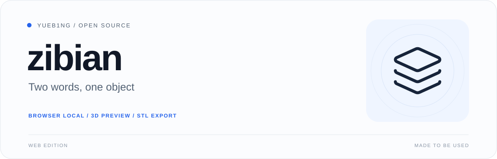
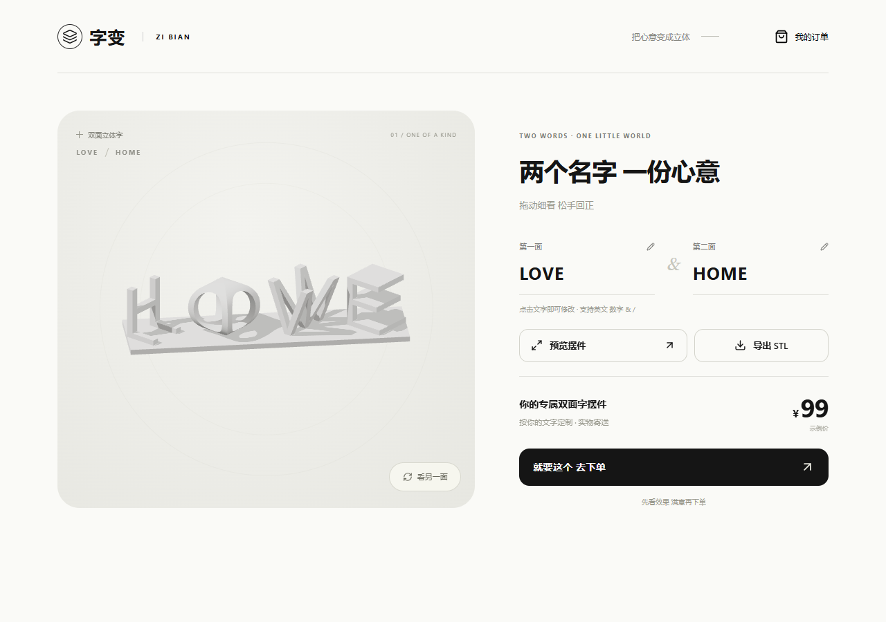
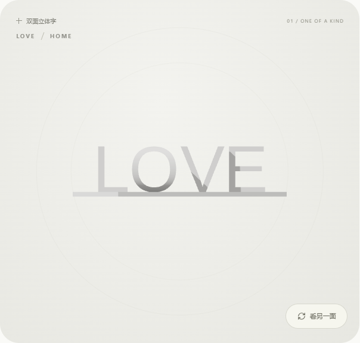
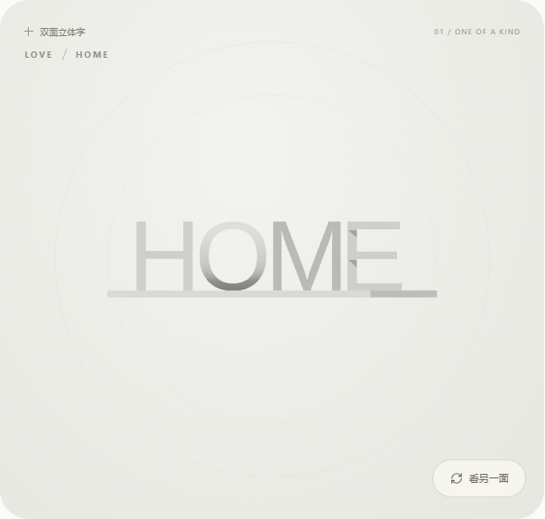

<p align="center"></p>
<p align="center"><a href="README.md">简体中文</a> · <b>English</b></p>
<p align="center"><a href="https://github.com/YUEB1NG/zibian/actions/workflows/build.yml"></a> <a href="LICENSE"></a> </p>

# zibian

**Two words, one object — a different message from each side.**

Generate dual-view 3D lettering in your browser, inspect both faces, and export the original mesh as STL. Geometry runs on your device with no generation server.

[Quick start](#quick-start) · [STL guide](docs/STL-export.en.md) · [Licensing](LICENSE-STATUS.md) · [Report an issue](https://github.com/YUEB1NG/zibian/issues)



| Generate locally | Inspect both faces | Export STL |
| --- | --- | --- |
| Browser-based Manifold WebAssembly | Spring-back dragging with gentle resistance near reading angles | Download the current millimetre-space mesh |
| 1–12 characters per side: A–Z, 0–9, `&`, `/` | Complete rectangular base and aligned front/side views | Edited text is regenerated before download |


## Try it and inspect the sample

[Live demo](https://yueb1ng.github.io/zibian/) · [Preview release and sample STL](https://github.com/YUEB1NG/zibian/releases/tag/v0.1.0-web-preview) · [Reproducible examples](docs/EXAMPLES.md) · [Contributing](CONTRIBUTING.md)

The live demo is built from this repository with the open Arimo glyph bank. These are two browser renders of the same LOVE / HOME mesh, not physical-print photographs:

| Front: LOVE | Side: HOME |
| --- | --- |
|  |  |

## Quick start

Use **Node.js 22.12 or a newer supported version**.

```sh
git clone https://github.com/YUEB1NG/zibian.git
cd zibian/frontend
npm ci
npm run dev:studio
```

Open the address printed in your terminal, normally `http://127.0.0.1:8877`. Append `-- --port 8878` if that port is occupied.

```sh
npm run build:studio
npm run preview:studio
```

Deploy `frontend/prototype-v2/dist` to a static web host. Serve Worker and WASM files over HTTP; use HTTPS for public access. Opening the HTML file directly is unsupported.

## From words to an object

1. Edit the two words beneath the model
2. Open the enlarged preview and use the face button to align each reading direction
3. Export STL, import it into your slicer as millimetres, and check dimensions, connected parts, orientation and supports

Display rotation and zoom do not change print dimensions. STL stores neither colour nor unit metadata. A watertight mesh is not proof of a successful physical print. Pricing, addresses, payment and orders are demonstration flows with no real transactions.

## Open font assets

The default is **Arimo Regular / SIL OFL 1.1**, including the source font, license, conversion script and glyph bank. OpenSCAD creates complete glyph outlines normalized to a height of 100. A 0.2 mm overlap connects rounded glyph bottoms to the base instead of leaving tangent-only contact.

The earlier preview uses Tahoma. Fonts produce different outlines, layouts and dimensions. This repository contains no Tahoma font or glyph bank and makes no claim of vertex-for-vertex equivalence. The historical preview keeps its existing URL and appearance.

<details>
<summary><b>Rebuild glyphs and run development checks</b></summary>

Python and OpenSCAD are only required to rebuild the glyph bank:

```sh
python -m pip install -r requirements-glyphs.txt
python scripts/export_glyphs.py --openscad /path/to/openscad
node scripts/generate_sample.mjs
```

On Windows, pass OpenSCAD's `.com` executable. When changing fonts, remeasure widths and complete outlines and verify the font's redistribution license.

From the repository root:

```sh
node tests/geometry.mjs
node tests/stl-export.mjs http://127.0.0.1:8877/
```

Keep the local server running for browser checks. Install Chromium with `npx playwright install chromium` inside `frontend`, or set `BROWSER_PATH` to Chrome / Edge. Checks cover 38 glyph bounds, eight generated models and download failure paths; device testing and physical prints remain separate.

</details>

## Scope and licensing

This is the open-source Web edition. WeChat Mini Program and Android / iOS projects will be prepared separately; this is not an app-store release or a claim of mobile-device validation.

The owner supplied and confirmed ownership of `original/字变.py`. Its original Mc_Fly / POV nametag attribution remains intact. Project code is [MIT](LICENSE), the font and converted glyph bank are [OFL-1.1](assets/fonts/OFL.txt), and dependencies retain their own licenses.

---

By [YUEB1NG](https://github.com/YUEB1NG) · Also see [liulaogen](https://github.com/YUEB1NG/liulaogen)
