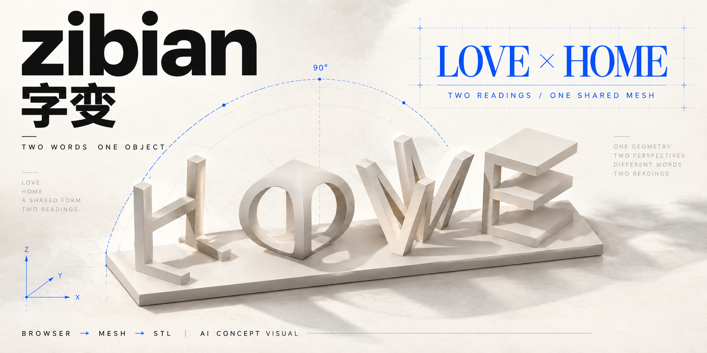

<p align="center"></p>

<p align="center"><sub>AI 概念封面 · 真实界面与模型检查见下文</sub></p>
<p align="center"><b>简体中文</b> · <a href="README.en.md">English</a></p>
<p align="center"><a href="https://github.com/YUEB1NG/zibian/actions/workflows/build.yml"></a> <a href="LICENSE"></a> </p>

# zibian · 字变

**两组文字 一个摆件 换个角度看见另一份心意**

在浏览器里生成双面立体字，拖动细看，正对两面，再把原始网格导出为 STL。计算留在你的设备上，无需生成服务器。

<p><a href="#快速开始">快速开始</a> · <a href="docs/STL导出.md">STL 说明</a> · <a href="LICENSE-STATUS.md">许可与字体</a> · <a href="https://github.com/YUEB1NG/zibian/issues">反馈问题</a></p>


| 本地生成 | 双面查看 | STL 导出 |
| --- | --- | --- |
| Manifold WebAssembly 在浏览器中计算 | 拖动回弹 接近读字角度时轻微吸附 | 下载当前文字的毫米坐标网格 |
| 每面 1–12 位英文 数字 `&` `/` | 保留完整矩形底座与两面正视视角 | 改字后自动重新生成 防止下载旧模型 |


## 在线体验与模型示例

[在线体验](https://yueb1ng.github.io/zibian/) · [预发布版本与 STL 样品](https://github.com/YUEB1NG/zibian/releases/tag/v0.1.0-web-preview) · [可复现示例](docs/EXAMPLES.md) · [贡献说明](CONTRIBUTING.md)

在线版从本仓库构建，使用开源 Arimo 字形。以下为同一个 LOVE / HOME 模型的浏览器渲染，不是实际打印照片：

| 第一面 LOVE | 第二面 HOME |
| --- | --- |
|  |  |

## 快速开始

需要 Node.js **22.12 或更新的受支持版本**。

```sh
git clone https://github.com/YUEB1NG/zibian.git
cd zibian/frontend
npm ci
npm run dev:studio
```

打开终端显示的地址，默认 `http://127.0.0.1:8877`。端口占用时追加 `-- --port 8878`。

```sh
npm run build:studio
npm run preview:studio
```

构建产物在 `frontend/prototype-v2/dist`，可部署到普通静态网站服务。使用 HTTP 加载 Worker 与 WASM，公开访问推荐 HTTPS，不要直接双击 HTML。

## 从文字到实物

1. 点击下方两组文字，输入想表达的内容
2. 点「预览摆件」放大检查，「看另一面」依次对准两面
3. 点「导出 STL」，在切片器中按毫米导入并检查尺寸、连接、朝向与支撑

显示缩放与旋转不改变实物尺寸。STL 不保存颜色或单位元数据，封闭网格也不等于已通过实际打印验证。价格、地址、支付与订单目前是流程演示，没有接入真实交易。

## 开源字形

默认使用 **Arimo Regular / SIL OFL 1.1**，附带源字体、许可、转换脚本与字形库。字母由 OpenSCAD 生成，完整高度归一化到 100，嵌入底座 0.2 mm，以免圆弧底部只在一个点接触。

早期体验版使用 Tahoma。不同字体的轮廓、排版与尺寸不同，本仓库不包含 Tahoma 字体或字形数据，也不宣称与它逐顶点相同。历史体验网址保留原地址与外观。

<details>
<summary><b>重新生成字形与开发检查</b></summary>

日常使用无需 Python 或 OpenSCAD。重新转换字形时运行：

```sh
python -m pip install -r requirements-glyphs.txt
python scripts/export_glyphs.py --openscad /path/to/openscad
node scripts/generate_sample.mjs
```

Windows 可传 OpenSCAD 的 `.com` 文件。替换字体时重新测量字宽与完整轮廓，并检查许可。

从仓库根目录运行：

```sh
node tests/geometry.mjs
node tests/stl-export.mjs http://127.0.0.1:8877/
```

浏览器测试需保持服务运行。在 `frontend` 执行 `npx playwright install chromium`，或通过 `BROWSER_PATH` 指定 Chrome / Edge。测试包括 38 个字形包围盒、8 组模型与下载错误路径；不能替代真机和实际打印。

</details>

## 项目范围

这是 Web 开源版。微信小程序与 Android / iOS 原生工程后续单独整理，不代表已上架或完成真机验证。

`original/字变.py` 为项目所有者提供并确认自有的原始算法，原有 Mc_Fly / POV nametag 署名和来源注释保留。代码采用 [MIT](LICENSE)，字体与转换字形采用 [OFL-1.1](assets/fonts/OFL.txt)，第三方依赖保留各自许可。

---

来自 [YUEB1NG](https://github.com/YUEB1NG) · 另一个项目 [liulaogen](https://github.com/YUEB1NG/liulaogen)
